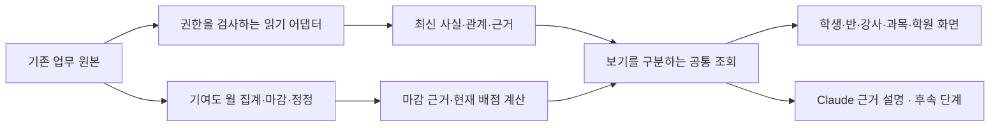

# 학생 중심 학원 온톨로지 확장 계획

작성일: 2026-10-22. 기준 코드: `250a3945e8eb32b3b3a8158a754f4e1fb13d6cb5`.
상태: 단계별 실행 계획안. 구현·운영 활성화 승인을 뜻하지 않는다. [Claude와의 검토 기록](student-ontology-expansion-review.md).

## 1. 목표와 첫 출시

학생 한 명을 열면 **현재 수강과 담당자, 최근 기록, 남아 있는 업무, 판단 근거**를 함께 확인한다. 같은 근거를 반·강사·과목·학원 관점으로 조회하고, 이후 명시적 버튼으로 Claude의 정해진 목적별 요약을 생성한다. 기여도는 이 구조를 사용하는 여러 기능 중 하나로 유지한다.

첫 출시는 **기존 `/student-contribution/[id]` 안의 ‘현재 연결’ 읽기 전용 블록**이다. 수강·담당 관계, 최근 상담·메모, 기존 보강 상태, 확인된 보호자·형제를 연결한다. 월 계산 영역과 분리해 스트리밍하고 기존 학생 상세·이력·업무 화면으로 `EmbedLink`를 사용해 이동한다. 새 메뉴나 학생 관리 화면을 만들지 않는다. 기존 학생 상세의 타임라인 표시·월 이동은 유지한다.

초기 화면과 조회가 답해야 할 질문은 다음 다섯 가지다.

1. 이 학생은 지금 어느 반을 다니며, 특정 날짜에는 어느 반에서 누구에게 배웠는가?
2. 최근 상담·메모·수강 변경에 어떤 기록이 있고 원본은 어디인가?
3. 기존 보강 예약의 예정·완료·취소 상태와 기록할 반·결석난 반·해당 출결은 무엇인가? 새 보강관리를 사용할 수 있는 경우에는 그 장부의 열린 건·점유·인정 분량을 별도로 확인한다.
4. 이 학생의 기여도는 어떤 원자료와 현재 배점으로 계산됐는가?
5. 지금 확인할 수 없는 자료는 무엇이며, 조회 실패·미연결·기록 없음 중 어떤 상태인가?

위 질문은 화면의 수용 기준이며 자유 질문 입력창을 뜻하지 않는다. 새 보강관리가 꺼져 있거나 도입 여부가 확인되지 않으면 해당 범위를 설명하되 기존 예약은 기존 권한으로 조회한다. 기존 경로에 없는 인정 분량을 0분으로 만들지 않는다. 보강 미연결 결석은 ‘자격 판단 전’이며 의무로 세지 않는다.

## 2. 이미 있는 것과 확장할 부분

이번 조사는 저장소의 코드와 기록 문서에 한정한다. 운영 DB의 현재 스키마·설정·활성화 상태를 새로 조회하지 않았다. 오래된 계획 문서만으로 운영 완료를 판정하지 않는다.

| 영역 | 확인한 구현 근거 | 확장 계획 |
| --- | --- | --- |
| 공통 학생 사실 | `src/features/students/ontology/{types,identity,facts,aggregate,explorer,visible-facts}.ts` | 기존 식별·근거·유효기간 계약을 유지하고 아래 최신/마감 자료 계약을 추가 |
| 기여도 | `src/features/student-contribution/server/{store,refresh,ontology-query,student-months}.ts` | 월 마감 및 정정 원장을 독립 소비자로 보존. 최신 업무 조회의 원장으로 사용하지 않음 |
| 학생 이력 | `src/features/students/server/queries.ts`의 `getStudentTimeline`, `enrollment-history.ts` | 상담·메모·성적·교재·수강 이력을 재사용하되 원본 ID, 오류 상태, 서버 페이지 조회 보강 |
| 학생/수강 권한 | `students/server/{read-scope,enrollment-gate}.ts`, `student-contribution/server/{access,fact-access}.ts` | 메뉴 허용과 원본별 담당 범위를 각각 검사. 병합 전 기록에도 원본 범위 적용 |
| 보강 | `attendance/server/makeup-reservation-queries.ts`, `attendance/makeup-reservation.ts`, `makeups/server/{queries,actions,read-types}.ts` | 기존 예약 조회와 새 장부 RPC를 연결. 새 장부의 의무/점유/인정은 RPC 결과를 쓰고 프런트에서 재계산하지 않음 |
| 상담·보호자 | `consultations/server/`, `students/server/{queries,siblings}.ts` | 작성자·공유 범위 보존. 이름·연락처로 보호자나 형제를 자동 병합하지 않음 |
| 학습·교재 | `grades/server/`, `progress/server/`, `math-progress-map/model.ts`, `textbooks/server/` | 기존 점수·진도·교재 사실부터 연결. 개념 숙련도 모델은 별도 후속 단계 |
| AI 공통 기반 | `src/lib/ai/{generate,models,model-features,fact-guard}.ts`, `consultations/server/actions.ts` | 고정 목적의 요약과 자료 수집 어댑터 재사용. 범용 도구 질의기를 만들지 않음 |
| 속도 | 기여도의 compact cache, 선택 월 조회, 범위별 캐시 | 전체 원자료를 화면마다 다시 읽는 구조로 되돌리지 않음 |

보강은 기존 예약·새 보강관리·직원 포트폴리오 판정의 뜻이 다르다. `legacyMaps`의 명시 연결로만 중복을 제거하고 미연결 예약은 보존한다. `absenceClassOf`로 기록할 반과 결석난 반을 구분한다. 기존 예약 완료, 포트폴리오의 보강 완료, 새 장부의 인정은 원천 이름을 붙여 따로 표시한다. 숨은 보강 반(`is_makeup_pool`)을 일반 반 엔티티로 노출하지 않는다. `off/draining` 검사를 유지하고 꺼짐 때문에 기존 예약까지 숨기지 않는다. [기존 출시 기록](../features/makeups/release-review.md)은 당시 기본 꺼짐이며 현재 상태는 P0에서 읽기 전용으로 확인한다.

학생 이력은 일부 종류에서 원본 ID 없이 표시값만 조회한다. 필요한 원본 ID를 선택 필드로 추가하되 기존 타임라인 표시를 바꾸지 않는 회귀를 확인한다. 기존 온톨로지의 강사 관점은 `ontology-facts.ts`의 시간표 기준이므로 ‘시간표 기준 · 마감 당시 판정’을 표시하고 관계 판정 버전을 남긴다. 과거 저장값을 소급 변경하지 않는다.

## 3. 바꾸지 않는 결정

[학생 온톨로지 및 D1~D8](../decisions/student-ontology.md)을 따른다. 만점 없는 누적, 자동 활동 판정, 현재 배점으로 재계산, 월 원자료 마감과 열린 달 정정, 소개 인정 조건은 유지한다. 이번 확장이 지표·배점·재원 산식 변경을 포함하지 않는다.

기본 공개는 원장 이상이며 기존 개인별 허용 예외를 보존한다. 초기 확장은 현재 메뉴·수납 두 권한 및 실험실/시범 지점 조건 안에서 제공한다. 학생 상세의 연결 입구도 같은 조건으로 표시한다. 공통 읽기 계층은 원본 권한을 따로 검사하며, 원본의 권한을 넓히는 효과를 만들지 않는다. 이후 일반 직원에게 수납 없는 통합 보기를 여는 것은 별도 공개 범위 결정이다.

학생 → 반 → 강사 → 과목 → 학원은 조회 축이다. 복수 수강·공동 담당·담당 기간을 표현하는 관계를 저장하고 하나의 부모에 강제로 귀속하지 않는다. 직원 근태·시설·지출은 해당 대상의 원본으로 확장할 수 있으며 학생 자료 합만으로 학원 전체를 설명하지 않는다.

## 4. 데이터 계약과 책임

기존 DB를 원본으로 유지한다. 각 기능의 읽기 어댑터 → 공통 조회 → 화면/Claude 순서로 연결한다. 기존 업무 명령은 해당 기능이 계속 소유한다. 새 거대 원장, 그래프 DB, 벡터 DB, RDF 변환은 초기 필수 조건이 아니다.

그림의 공통 조회도 요청마다 권한을 확인한다. 위 두 자료 흐름을 단순히 합산하지 않는다.

| 계약 | 구현 기준 |
| --- | --- |
| 식별 | `tenant + 원본 종류 + 원본 ID`를 안정 식별자로 사용. 현재 학생 ID와 원본 학생 ID를 함께 유지. 복합 키 원본은 그 키의 범위를 명시 |
| 시간 | 실제 발생일/기간, 원본의 기록·수정 시각, 조회/집계 시각을 구분. 모르는 날짜는 미확인. 월 자료를 임의 날짜로 변환하지 않음 |
| 관계 | 수강·담당의 유효기간과 당시 근거를 보존. 기간 미확인과 종료일 없음은 구분. 현재 담당자를 과거 담당자로 대체하지 않음. 관계 시점과 열람권한 판정시점은 별개 |
| 보기 모드 | `최신 업무 기록`과 `마감 당시 기여도 근거`를 명시적으로 구분. 같은 원본의 두 표현을 합계에 중복 포함하지 않음 |
| 개정/취소 | 최신 보기는 원본 수정·삭제·취소를 반영. 마감 근거는 기존 보존 규칙을 따르되 현재 열람권한은 다시 검사. 삭제/비식별 정책은 보존 의무와 구분해 정의 |
| 근거 | 원본 ID·조회 경로·규칙 버전·AI 사용 여부를 반환. 권한 없는 원문의 내용·제목·존재 건수가 링크나 캐시로 새지 않게 검사 |
| 자료 상태 | 값과 별도로 조회 성공/일부/실패/기능 꺼짐/권한 없음/미연결, 적용 기간·갱신시각을 반환. 권한 없음에는 존재 여부·건수 미노출. 실패·미확인을 0이나 정상으로 바꾸지 않음 |
| 업무 상태 | 기록된 상태와 업무상 잔량은 기존 도메인 함수로 계산. 결석≠보강 자격, 예약≠실시, 실시≠인정. 연결이 불완전하면 자동 종결하지 않음 |
| 집계 | 집계별 모집단·단위·기간·중복 제거 키·배분 여부·미확인 건 처리 명시. 인원은 중복 제거하고 금액은 임의로 반/강사에 배분하지 않음 |
| 권한 | 요청마다 실제 사용자·지점·메뉴·원본·담당 범위를 검사. 학생 병합이 과거 원본의 열람권한까지 합치지 않음. 화면·검색·AI·다운로드 동일 규칙 |

계약 확장은 기존 타입의 버전/어댑터 호환 경로로 도입한다. 과거 월 JSON을 일괄 수정하거나 새 필드가 없다는 이유로 마감 자료를 최신 기록으로 취급하지 않는다. 스냅샷 자료와 최신 조회 결과는 서로 다른 응답 타입으로 만들고 타입 검사와 중복 사례로 혼합을 막는다.

P1의 선행 보완을 명시한다. `ontology-views.ts`, `student-months.ts`, `student-query.ts`의 긍정 신호 원문·인용도 원본 학생/내용 권한으로 거른다. 삭제·접근 제한·연결 오류가 있는 원문은 읽기 단계에서 가리고 마감 수치·ID는 유지한다. 원본을 확인하지 못하면 본문을 보류한다. P2는 마감 본문을 새 블록에 복제하지 않고 기존 월 계산/근거 영역으로 연결한다. 저장된 본문 자체의 삭제·비식별은 별도 보존 정책과 승인된 마이그레이션이 필요한 경우에만 진행한다.

끊긴 병합·순환 연결은 해당 학생/연결 집합만 ‘확인 필요’로 격리하고 전체 화면을 실패시키지 않는다. 그 자료를 빠뜨린 합계는 완전한 값으로 표시하지 않는다. 최신 관계는 원본에서 읽어 실제 화면에서 소비하고, 기존 월 `payload.relations`는 그대로 보존한다. 새 도메인의 관계·본문을 기여도 밤 전체 재계산이나 월 payload에 더 넣지 않는다.

보강 어댑터는 `sharedRead`의 권한 거절→off 변환을 그대로 사용하지 않고 실제 모드와 원본 열람 가능 여부를 구분한다. 운영 콘솔의 읽기 전용 지점 보기에서 닫힌 보강관리 RPC를 admin 클라이언트로 우회하지 않는다. 원본마다 실패·권한·기능 상태를 보존한다.

| 관계 역할 | 조회 근거와 표시 |
| --- | --- |
| 그날 담임 | `homeroomTeacherOnDate`의 감사로그 기반 구간. 보고서 작성자 추정은 따로 표시하고 근거 이전은 미확인 |
| 시간표 담당·위임 | 유효한 교시 일정과 위임 기간. 배정 사실이며 실제 실시로 단정하지 않음 |
| 출결의 수업 귀속 | `resolveRecordTaughtBy` 재사용. `taught_by`의 대신 보강/JJ실 시수 이동 의미를 구분. 기록이 없으면 ‘시간표 기준’으로 표시 |
| 보고서 작성자·상담자 | 작성한 사람/상담한 사람의 원본 필드. 담임이나 실제 수업자로 자동 전환하지 않음 |

첫 블록은 학생 한 명의 최근 N건과 별도 count를 조회한다. 더 많은 이력은 기존 월 페이지로 연결하고 원본 목록의 페이지 처리를 재사용한다. 기존 타임라인의 빠른 월 이동은 유지한다. 원본별 서버 페이지와 큰 목록의 SQL 집계는 적용하되, 모든 원본을 합치는 커서 병합은 실측상 필요할 때 도입한다. 도입 시 안정 정렬·기준시각·쓰기 중 페이지 경계 계약도 함께 정의한다.

실측상 필요하면 재생성 가능한 조회 전용 표/요약을 추가한다. 이때만 원본 개정·삭제 표식, 동기화 체크포인트, 재실행 중복 방지, 전체 재구축, 대사, 지점/권한 격리를 함께 구현한다. 원본 저장 실패와 파생 조회 갱신 실패를 구분한다.

## 5. 화면과 관점 집계

‘현재 연결’ 블록은 현재 수강·역할별 담당·자료 갱신시각, 경로별 보강 상태, 최근 이력과 원본 링크 순서다. 한 학생·최근 기간만 조회하고 펼칠 때 필요한 자료를 가져온다. 기존 학생 상세와 기여도 화면의 창 모드·뒤로 가기·필터 상태를 이어 준다.

반·강사·과목·학원 화면은 먼저 좁은 요약을 표시하고 선택한 대상의 학생과 근거로 내려간다. 전체 그래프를 한 번에 그리지 않는다. 관계도는 선택 대상의 직접 연결부터 펼치며 목록으로도 동일 탐색을 제공한다.

차트는 실제 질문에 쓰이는 것만 둔다: 기간별 기록/참여 변화, 미처리 업무의 발생 시점·진행 상태, 기여도 계산 항목의 구성. 자료 기간·분모·단위·불완전 여부와 상세 근거를 함께 보여준다. 자료가 없는 기간을 0점으로 이어 그리거나 학생의 기여도를 강사 성과 점수로 바꾸지 않는다. 교사 순위나 새로운 위험 등급은 이번 범위에 없다.

넓은 화면은 가로 공간을 활용하고 모바일은 한 열로 전환한다. 숫자 우측 정렬·단위 고정·일관된 소수점, 서버 페이지네이션, 필터 유지, 키보드 이동, 로딩/실패/빈 상태를 공통 기준으로 삼는다. 개발 용어는 상세 도움말에 한정하고 화면 제목은 ‘학생 기록’, ‘연결된 수업’, ‘처리할 업무’처럼 표현한다.

## 6. 목적이 정해진 Claude 요약

[2026-09-03 결정](../decisions/ops.md)은 ‘어떤 형태의 챗봇·질의응답 패널도 재제안 금지’다. 자유 질문·대화·모델이 도구를 고르는 반복 실행·학생 검색 도구는 계획에서 제외한다. 원장이 향후 명시적으로 결정을 바꾸기 전에는 착수하지 않으며, 이번 계획을 위해 재질문하지 않는다.

P4는 이미 선택한 학생 한 명과 기간에 대해 서버가 **고정된 조회 묶음**을 조립하고, ‘최근 기록 요약’처럼 목적이 정해진 버튼으로 Claude 설명을 생성·저장하는 방식이다. 재생성도 명시 버튼으로만 한다. 근거 ID·원문 범위·규칙 계산값을 서버가 검증하고 모델이 반환한 근거 ID가 입력에 실제 있는지 사후 검사한다. 숫자는 서버 계산값을 표시한다. 근거 부족이나 권한 부족을 추측으로 메우지 않는다.

`generateJSON()`·`FACT_GUARD`·지점 라이선스·사용량 기록을 재사용한다. 새 기능을 `FEATURE_KEY_GROUP`의 `student_ontology`에 등록하고 키 그룹 테스트를 갱신한다. `STUDENT_ONTOLOGY` 전용 키와 `allowedProviders: ["anthropic"]`를 적용하며 API 키 추가 입력은 필요하지 않다. 빠른 Claude/낮은 추론부터 근거 정확도·시간·비용을 평가하고 필요할 때만 티어를 조정한다.

수업료 금액·학부모 원문 전체는 초기 AI 입력에서 제외한다. 허용된 내용도 필요한 짧은 근거만 보내고 기존 외부 전송 금지 필드를 유지한다. 자료 속 지시문은 자료로 취급한다. 조회량·토큰·시간·지점별 비용 상한과 취소/실패 처리를 둔다. 저장된 요약을 보여줄 때도 현재 원본 권한·개정을 확인하고 철회된 근거가 있으면 기존 요약 본문을 보류한다. 로그에는 원문 대신 근거 ID·모델·사용량·상태를 남긴다.

기존 원생 AI 케어의 자료 수집도 같은 어댑터를 사용할 수 있는지 검토하되 기존 기능의 모델/키 정책 변경을 이 확장에 자동 포함하지 않는다. 온톨로지에는 별도 실행 명령이나 AI 쓰기 래퍼를 만들지 않는다. 예약·취소·인정·발송은 기존 권한이 적용되는 원본 업무 화면으로 연결한다.

## 7. 실행 순서와 통과 조건

| 단계 | 산출물 | 완료 조건 |
| --- | --- | --- |
| P0 실제 연결 범위 확정 | 첫 출시와 대표 질문이 사용하는 원본/reader/writer/권한/이력 인벤토리, 정답·근거, 운영 상태 읽기 전용 확인 | 기존 인벤토리 재사용. 각 원본의 식별 키·시점·실패 동작, 보강 활성화와 이관 상태 구분 |
| P1 공통 읽기 계약 | 버전 있는 응답 계약, 수강/상담/메모/보강 어댑터, 기간/권한/중복 순수 판정과 Vitest | 원본 화면과 값 일치, 동일 사건 두 번 집계 0, 불완전 자료 거짓 0건 없음, 권한 회귀 통과 |
| P2 학생 통합 보기 | 기존 화면을 활용한 현재 상태·할 일·이력·근거, 서버 페이지/필터 | 다섯 대표 질문을 AI 없이 해결. 실제 연결 범위만 표시. 모바일·키보드·뒤로 가기·실패/재시도 확인 |
| P3 상위 관점과 나머지 자료 | 반/강사/과목/학원 집계, 성적·진도·교재·학부모 글 등 어댑터를 한 영역씩 추가 | 모집단·기간·분모·미귀속 값이 일치. 다대다 집계 중복 없음. 선택 조회 성능 통과 |
| P4 목적별 Claude 요약 | 선택 학생의 고정 조회→명시 버튼→저장→근거 검증, 사용량/오류 관측 | 권한 누출 0, 근거 없는 확정 설명 0, 호출 상한·취소·저장 결과의 권한 재검사 확인 |
| P5 학습 개념 확장 | 기존 진도/성적·외부 식별자 조사, 개념/교재·문항 버전/시도/근거 있는 추정 설계 | 실제 원자료와 교사 검증 확보. 제한된 과목/교재부터 평가하며 원자료 부재는 미확인 |

P0~P2가 첫 구현 묶음이다. P3 전체가 끝나야만 P4를 시작할 필요는 없다. **P2에서 검증된 자료의 목적별 요약**부터 시범 운영할 수 있다. 학습 개념 모델도 원문항/교재/과정 버전 조사와 교사 검증을 선행한다. 기존 `math-progress-map/learning-dashboard.ts`의 실제 차시 원장 변환은 재사용 후보이며 학습 자료 전체를 샘플로 취급하지 않는다. 한 번의 오답을 개념 미숙으로 확정하지 않는다.

P3의 자료 연결은 다음 순서로 나눈다. 각 묶음은 원본 대조·권한·속도 기준을 통과한 뒤 공개한다.

- 출결·영상 숙제·시험·진도·교재: 제출/완료/검사/응시/점수를 서로 구분하고 원본의 현재 판정을 재사용한다.
- 학부모 글·상담 후속조치·퇴원/재원 관련 기록: 원문, 관찰된 변화, 규칙/AI 해석을 나누고 상담 작성자·공유 범위를 보존한다.
- 셔틀·학생 관련 문서·안내/승인 이력: 학생 ID 연결과 원본 권한이 확인된 부분부터 추가한다. 발송 성공과 실제 읽음/응답을 혼동하지 않는다. 관련 없는 문서나 제한된 개인정보를 모으지 않는다.
- 직원·강의실·학원 운영: 학생에게 직접 귀속되지 않는 사실을 독립 대상에 연결한다. 직원 평가·급여·지출을 학생 총점으로 유추하지 않고 업무별 정책과 권한을 먼저 정의한다.

보호자 관계의 독립 ID, 관계 종류·유효기간·열람/연락 권리는 현재 학생의 이름/전화 필드만으로 복원할 수 없다. P0에서 실제 저장 범위를 확인하고 첫 출시에서는 확인된 현재 필드만 사용한다. 다중 보호자 이력이나 보호자 계정 권한은 데이터 모델과 정책이 정해진 후 추가한다.

## 8. 검증과 성능 기준

먼저 합성 자료와 원본 대조용 사례를 만든다. 원본 정답/권한을 확인하지 않은 AI 답변끼리의 비교는 수용 검증으로 세지 않는다.

| 필수 사례 | 기대 결과 |
| --- | --- |
| 동명이인·알파벳 이름·병합 전 학생 | 자동 인물 합치기 없음. 원본 식별과 권한 유지 |
| 두 과목·두 반·공동 담당 | 학원 인원 중복 없음. 당시 담당과 현재 담당 구분 |
| 반 이동·퇴원·삭제된 수강 | 확인 가능한 이력/열린 업무 보존. 근거 없는 과거 상태 복원 없음 |
| 원본 수정·삭제·환불 | 최신 기록 갱신, 마감 기여도와 정정 규칙 보존, 합계 혼합 없음 |
| 출결 미입력·조회 실패·1001건 이상 | 결석/0건으로 오판하지 않음. 뒤 페이지도 누락 없음 |
| 보강 예약 취소·노쇼·부분 실시·인정 반전 | 잔량·약속·실시를 구분하고 기존 도메인 결과와 일치 |
| 메뉴 개인 허용·수납 차단·담당 범위·다른 지점 | 화면/근거/합계/검색/AI/캐시 모두 동일 범위 |
| 원문 속 지시·입력에 없는 근거 ID·근거 부족 | 지시 수행/근거 조작/추측 설명 없이 범위 표시 |
| 조회 중 수정·권한 회수·오래된 캐시 | 개정/기준시각 일관성, 현재 권한 재검사, 재조회 가능 |
| 원본 업무 링크·창 모드·권한 회수 | 올바른 기존 화면 진입, 조회/쓰기 권한을 우회하지 않음 |

P0에서 최소 20개의 입력·기대값·근거·권한 사례로 위 기준을 구체화한다. 수정한 함수/어댑터/화면과 직접 의존 범위만 검사한다. 계산 함수는 기존 Vitest coverage 규칙을 따르고, RLS/DB 명령 변경 시 관련 SQL·권한·동시성 검사를 추가한다. 공통 기반 변경으로 영향 근거가 있을 때만 검사 범위를 넓힌다. 문서 작성만 한 이번 작업에 전체 테스트를 실행하지 않는다.

성능은 P0에서 동일 환경의 cold/warm p50/p95, DB 시간·조회 수·전송량·화면 전환 시간을 기록한다. P2 제안 목표는 warm 첫 조회/탭 이동 p95 1.5초 이내, cold 3초 이내이며 P0 실측으로 현실적인 기준을 문서화한다. 숫자를 달성하지 못했다고 자료를 생략하지 않는다. 이미 배포한 기여도 네 탭도 같은 환경의 기준 대비 회귀를 확인한다. AI 대기시간은 일반 화면 로딩과 분리한다.

전체 학생의 원문 JSON 전송 금지, 선택 대상/기간만 조회, 집계는 SQL/RPC, 큰 ID 목록은 청크×페이징, 독립 조회 병렬화, 차트 지연 로딩을 적용한다. 캐시는 지점·원본 범위·권한 범위·기간·자료 버전을 키에 포함하며 권한 판정을 캐시로 대체하지 않는다.

## 9. 결정이 더 필요한 시점과 도입

지금 D1~D8이나 기존 공개 권한을 다시 묻지 않는다. P0~P2는 현재 사실·기존 업무 정책·위의 원문 열람 보호로 진행할 수 있다. 후속 단계에서만 구체적인 시안/영향과 함께 결정한다: 수납 없는 직원 통합 보기 공개, 교재·문항 개념 체계와 추정의 활용 범위, 보존 자료의 실제 삭제·비식별 정책이 기존 규정만으로 해결되지 않는 부분. 새 보강 자동화·발송·질의응답 패널은 이 계획의 구현 범위가 아니다.

각 단계는 별도 변경 묶음으로 검토하고 시범 지점에서 원본 대조 후 확장한다. 새 어댑터/AI 기능을 끄면 기존 화면으로 돌아갈 수 있게 하며, 원본이나 마감 기록을 삭제해서 되돌리지 않는다. 새 조회용 표가 필요할 때 마이그레이션·재구축·대사 계획을 함께 제시한다. **운영 DB 쓰기, 마이그레이션 적용, 소개 백필, main 푸시·배포는 해당 변경의 승인 이후** 진행한다. 앞선 성능 개선 배포 승인을 이번 확장 전체 승인으로 사용하지 않는다.

## 10. 근거와 검토 기록

- [사용자가 제공한 온톨로지 조사 대화](https://chatgpt.com/share/6ada1b22-0708-83ec-ac88-53bc1449ac5b): 23절 보고서와 출처. 이번 계획에서는 원칙을 실제 코드에 대조했으며 외부 자료의 모든 주장·영상을 새로 검증한 것은 아니다.
- [현재 결정](../decisions/student-ontology.md), [기여도 적용·성능 기록](../features/student-contribution.md), [보강 도입 경계](../features/makeups/rollout.md).
- 보고서 추출본: `work/student-ontology-shared-report.json`. 독립 Claude 검토와 조율 결과는 [검토 기록](student-ontology-expansion-review.md)에 보존한다.
