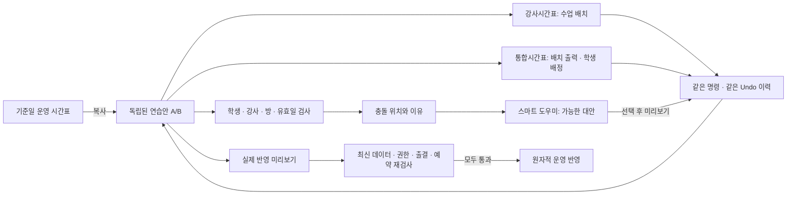

# 시간표 연습실 — 통합 계획

2026-10-03 · 상태: Claude/Grok 협의 계획 → 기존 시간표 뷰·색상 연결 → [반 편집·여러 연습본 저장·비교](class-editing-results.md) 구현 → **main 병합** → [앱 통합 · 완전한 편집기](app-integration-results.md)(시간표의 `시간표 편집기` 버튼 → `/timetable/editor`). 전체 단축키·운영 반영·수학 확장은 미완료.

## 만들려는 것

다음 달 시간표를 여러 안으로 만들고 자유롭게 옮겨 본다. 영어 강사시간표에서 수업을 배치하면 통합시간표에 같은 배치가 나타나며 학생을 배정할 수 있다. 충돌이 있어도 연습안은 저장되지만 이유가 보이고, 스마트 도우미가 가능한 대안을 제시한다. 실제 운영 반영은 별도의 미리보기와 재검사를 통과해야 한다.

## 확정된 사용자 요구

- 별도 워크트리에서 신중하게 진행한다. Codex 초안 → Claude/Grok 협의 → 통합 계획 → Codex 실행.
- 영어 먼저, 이후 수학. 공통 편집기는 재사용하고 과목별 규칙은 따로 검증한다.
- 영어 강사시간표는 수업 배치 작성, 통합시간표는 그 배치의 출력과 학생 배정을 맡는다.
- 연습에서는 충돌이 생기는 자리에도 놓을 수 있다. 실제 반영 시에는 불가능한 이유를 구체적으로 확인한다.
- Google Sheets의 단축키 전체를 호환 목표로 삼는다. Ctrl+C/V 정도로 요구를 축소하지 않는다.
- 스마트 도우미는 가능한 자리를 추천하고 영향과 조건을 설명한다. 사용자가 고른 안만 초안에 적용한다.
- JEV는 유용성이 검증되는 보조 역할에 활용한다.
- 엑셀 모양을 복제하는 것이 아니라, 수업을 자유롭게 옮기고 판단할 수 있는 편리함을 제공한다. 공간을 최대한 편집에 쓰고 기존 시간표를 불러올 수 있어야 한다.
- 구글 시트의 관리 대상 3개 탭만 갱신하고 추가 연습 탭은 보존하는 기존 요청도 포함한다.

## 문서 순서

1. [초안 v0](initial-plan.md): 사용자 요구와 코드 조사에서 시작한 원안.
2. [Claude 1차](reviews/claude-review.md) · [Grok 1차](reviews/grok-review.md) · [Claude 교차 검토](reviews/claude-consensus.md) · [Grok 교차 검토](reviews/grok-consensus.md): 실제 검토자의 원문.
3. [통합 결정](decisions.md): 검토 의견별 채택/수정/보류와 최종 근거. 검토 원문의 미채택 제안보다 이 결정과 사용자 요구가 우선한다.
4. [실행 계획](execution-roadmap.md): 독립 시트 보존 작업 + P0~P7 구현 단계와 통과 조건.
5. [단축키·클립보드 계약](keyboard-contract.md): 전체 호환 조사 방식, 복사/붙여넣기 의미, 실제 브라우저 시험.
6. [스마트 도우미](smart-assistant.md): 충돌 근거, 후보 탐색, 추천 순위, 실패/정보 부족/JEV 경계.
7. [완료 기준](acceptance.md): 사용자 시나리오와 기능·안전성·성능 검증 표.
8. [P0 실행 결과](P0-results.md): 실제 프로토타입, 시험 결과, 수정한 결함과 남은 통과 조건.
9. [앱 통합 · 완전한 편집기](app-integration-results.md): 진입 버튼·화면·권한, 새 항목 추가와 직접 조작, 코드가 놓인 자리, 검증과 한계.

## 진행 상태

| 항목 | 현재 상태 |
|---|---|
| 전용 워크트리 | 생성 완료, `chrismathone/timetable-lab` |
| Codex 초안/세부 요구/실행 순서 | 작성 완료 |
| Claude 도메인·저장·반영 검토 | 1차 + 교차 검토 완료 |
| Grok 격자·키보드·추천 검토 | 1차 + 교차 검토 완료 |
| 상호 쟁점 해소/통합 결정 | 완료. 엔진은 실험으로 결정, 수식 관련 남은 이견도 기록 |
| 단축키 실제 전수 시험/엔진 채택 | 공식 132개 기능 목록 확보, 일부 키 실행 검증, 전체/채택 미완료 |
| 구글 시트 추가 탭 보존 구현 | 미착수 |
| 연습실/스마트 도우미 구현 | 전체 크기 수업 블록 화면·공통 Undo·교시 학생 이동·기본 추천 구현 + 앱 화면(`/timetable/editor`)으로 통합. 운영 반영은 미완료 |
| 기존 시간표 가져오기 | 로그인·지점 권한을 검사하는 읽기 API 연결. 합성 응답/날짜·권한 시험 완료, 실제 계정 조회 검증은 남음 |
| 반 편집·학생 반 이동 | 반 이름 변경·병합·분리, 통합뷰 학생 드래그(새 반 전체 수업), 민트색 이동 표시·원래 반 안내, 단일 Undo 구현 |
| 수업 길이 변경 | 시작·종료 직접 편집과 40/50/60/80/90분 선택. 불러온 교시 설정·실제 수업 시간 범위만 허용. 회의 같은 비수업 일정은 끌어 옮길 때와 시간 폼 모두 운영시간 밖에 둘 수 있다 |
| 여러 연습본 저장·불러오기·비교 | Supabase 개인별 사본 저장 API와 목록·두 안 비교 구현. 원격 저장 테이블 적용·RLS 33개 통과(최종 스크립트로 재실행). 저장은 감사로그에 남는다. **실제 로그인 브라우저 왕복은 아직 하지 않았다**(저장된 연습본 0건) |
| 병목 개선 | 1,200배치 합성 자료에서 추천 약 4.1초→0.08초, 편집 이력 약 0.95초→0.06초. 학생 드래그 중 전체 보드 재렌더 제거 |
| 기본 과목·편집기 진입 | 직원 담당 과목을 첫 시간표로 선택(본 시간표·시간표(개발중) 둘 다). ‘시간표 편집기’ 버튼을 시간표 오른쪽 도구 묶음에 연결 — 편집기 창이 따로 열린다([앱 통합 결과](app-integration-results.md)) |
| 새 항목 추가·직접 조작 | 수업·반·회의·강사·학생 추가, 빈 칸 끌어 그리기, 끝 잡아 길이 조절, Alt+끌기 복제, 네모로 여러 개 고르기, 잠금·메모, 강사 열·학생·강의실 관리, 요약, 여러 단계 되돌리기. 끄는 동안 겹침 없이 놓을 수 있는 자리를 칠한다 |
| 운영 DB/시트 쓰기·배포 변경 | 저장용 독립 테이블만 추가. 수업·학생 운영 반영이나 시트 변경 경로는 없음. 2026-10-03 main에 병합 — 운영에는 연습실용 API 세 개와 '시간표 첫 과목 = 담당 과목'만 나간다 |

실측하지 않은 성능과 라이브러리 문서상 기능은 검증 완료로 표시하지 않는다. 이 문서는 기능 출시 보고서가 아니다.

2026-10-02 저녁에 Codex가 멈추고 Claude가 이어받아 검증·마무리했다. 최종 검증 수치, 고친 것, 남은 한계, main에 합칠 때 할 일은 [인계·마무리 기록](CLAUDE-HANDOFF-2026-10-02.md) 맨 위에 있다.

## 실행의 첫 단계

P0에서 같은 합성 영어 자료로 편집 엔진·단축키·한글 입력·클립보드·단일 Undo를 검증한다. 그 결과로 엔진을 고정한 뒤 초안 저장 → 강사 배치 → 통합 학생 배정 → 스마트 도우미 → 실제 반영 순서로 Codex가 구현한다. 구글 시트의 추가 탭 보존 S는 독립 작업으로 먼저 완료할 수 있다. 수학은 영어 흐름과 공통 계약을 검증한 뒤 별도 과목 어댑터로 확장한다.

핵심 합의는 한 상태/한 이력, 운영과 분리, 최종 상태 검사, 3-way 비교, 명시적 변경 반영, 결정적 추천이다. 수식 결과를 명시적으로 일정 값으로 확정하는 경로에는 Grok의 반대가 남아 있다. 자동 운영 변경 금지는 공통이며, 사용자 요구를 줄이지 않는 구체 구현 가능성은 P0에서 확인한다.
